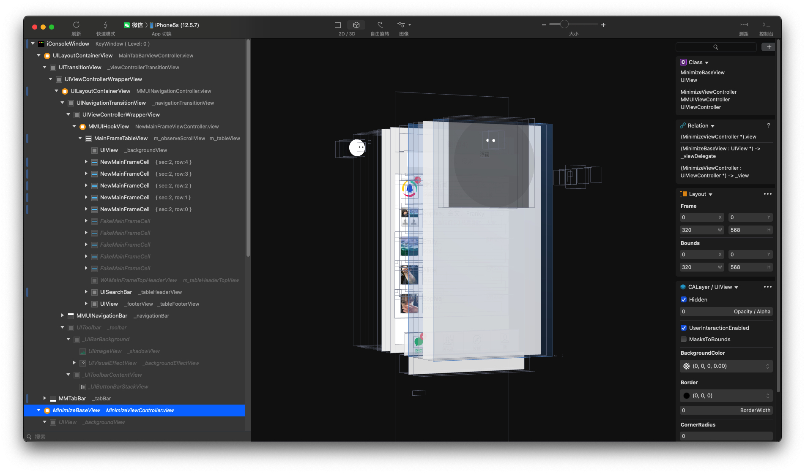
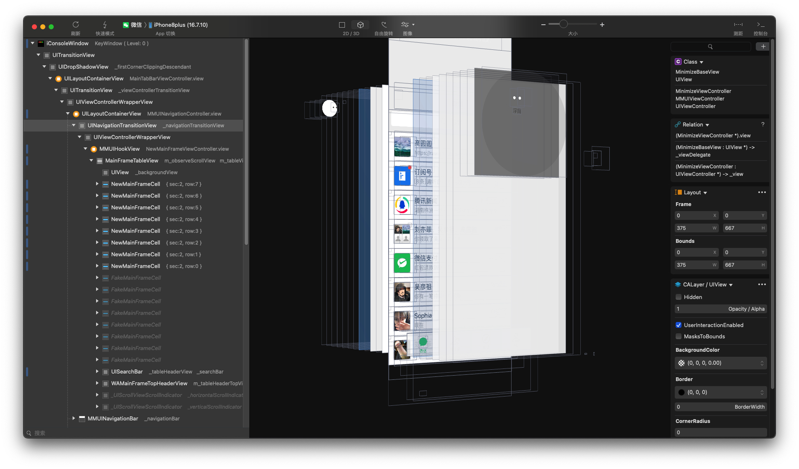

# LookinLoader2

[LookinLoader](https://github.com/creantan/LookinLoader) 的升级版，增加了对 rootless 越狱设备的支持。

An upgraded version of [LookinLoader](https://github.com/creantan/LookinLoader), adding support for rootless jailbroken devices.

理论上支持的版本是 iOS 7.0 - iOS 17.5。作者已在以下设备环境成功运行：

Theoretically supported versions are iOS 7.0 - iOS 17.5. The author has successfully tested it on the following environments:

* **Rootful**: iOS 12.5.7
* **Rootless**: iOS 16.7.10

---

## 截图 | Screenshots

**iOS 12.5.7 (Rootful):**

**iOS 16.7.10 (Rootless):**

---

## 如何安装 | How to Install

可以使用以下两种方式安装：

You can install it using one of the following two methods:

1. **软件源安装 | Via Repo**:

   添加软件源 [https://masterking.github.io/sileorepo/](https://masterking.github.io/sileorepo/)，搜索并点击安装使用。

   Add the repository [https://masterking.github.io/sileorepo/](https://masterking.github.io/sileorepo/), then search and install.

2. **源码安装 | Via Source**:

   下载源码，自行编译安装使用。

   Download the source code and compile it yourself.